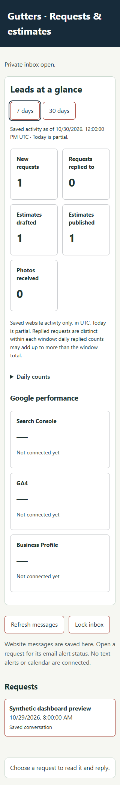
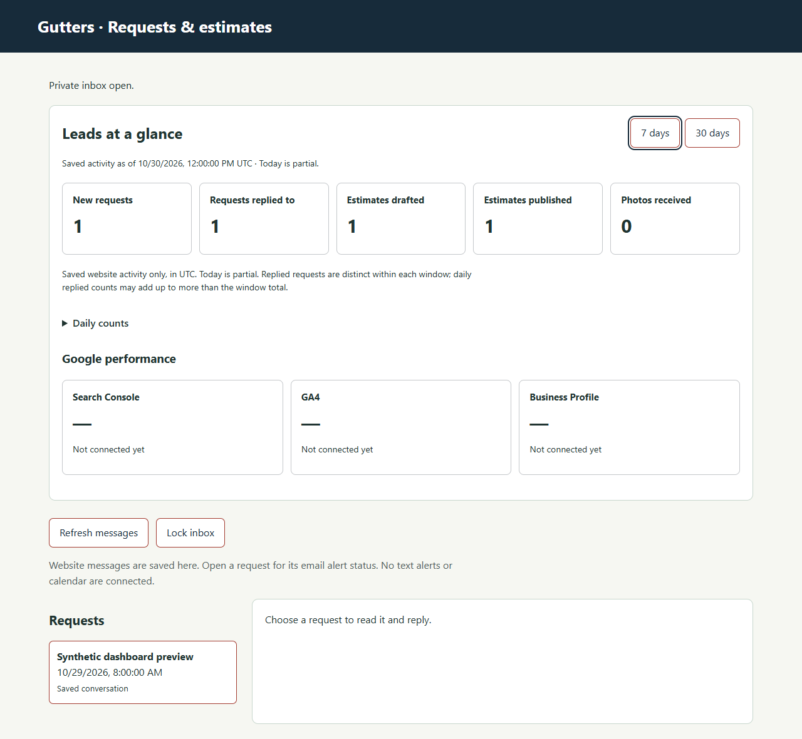

# Gutters owner dashboard

## Phase 1 — local counts, source only

`GET /owner/api/metrics` reads existing Gutters tables without a migration. It sits behind the same owner-bearer check, owner origin policy, rate limit, no-store headers and private indexing controls as the other owner reads. It returns only counts and their time metadata. No name, phone, email, address, request/estimate ID, photo filename or bytes, scope, amount, message text, access key or customer token is selected or returned.

A matching owner bearer is always required. An explicit Origin must equal the configured owner service origin; even an allowlisted marketing-site origin is rejected. As with existing owner GETs, an absent Origin is permitted because browsers commonly omit it on same-origin reads. Other methods are not supported. This does not add public CORS access to the dashboard.

### Time and counting contract

The response has one `asOf` snapshot timestamp, `timeZone: UTC`, `todayPartial: true`, and `windows.last7Days` / `windows.last30Days`. Each window provides `startInclusive`, `endInclusive`, `totals`, and chronologically ordered `perDay` rows containing `date` and `counts` with the same metric keys. A deferred SQLite read transaction holds one consistent snapshot across both windows.

Both windows include today up to and including `asOf`. The 7-day start is UTC midnight six dates before today; the 30-day start is midnight 29 dates before today. Future timestamps and events older than the start are excluded. For example, at October 30 12:00 UTC, the windows begin October 24 and October 1. These are calendar-date windows, not rolling 168/720-hour windows or John’s local calendar days.

| Key | Existing event and meaning |
| --- | --- |
| `newRequests` | Conversation records by `conversations.created_at`. Exact create retries do not add a second request. |
| `requestsRepliedTo` | Distinct conversation IDs with a **direct owner reply operation** during the window, by `operations.created_at` where `actor = owner`. Multiple replies and operation retries count once per request in that window. A daily row counts distinct replied requests on that day, so daily counts can sum above the distinct window total. Old requests replied to now are included. |
| `estimatesDrafted` | Estimate records by `estimates.created_at`, including drafts subsequently published. Each separately saved estimate/revision is its own record; idempotent retries are not. This is not the current unpublished backlog. |
| `estimatesPublished` | Estimate records by `estimates.published_at`. Publication's generated owner message does **not** count as a direct owner reply. |
| `photosReceived` | Saved photo records by `photos.created_at`, not filenames, download requests or byte totals. |

All five metrics are available from the existing schema. They measure only saved website records; they cannot establish calls, texts, off-site replies, booked jobs, revenue, lead quality or a conversion funnel. Expired/revoked return links do not remove retained records from these counts. No pricing or formula is introduced.

An empty successful database query produces measured zeros, including zero-filled dates within its known reporting window. Loading, failed or malformed local responses display unavailable dashes, never zero. Search Console, GA4 and Business Profile remain **null** in the panel model, shown as a dash and “Not connected yet.” These unknown Google metrics are not treated as empty database counts.

The panel is implemented in `server/src/owner-dashboard.mjs`; aggregation is in `server/src/owner-metrics.mjs`. The inbox has only import/template and login/refresh/lock hooks. Metrics failures cannot block reading or replying to saved requests. Late responses after lock are discarded. The existing bearer remains only in the inbox's memory; no second token store or login method is added. Notifications retain their existing off-by-default configuration; this phase never invokes a sender.

## Phase 2 — read-only Google totals

Integrate reviewed aggregate snapshots from [collector PR17](https://github.com/Palle017/Gutters/pull/17) only after the actual Gutters properties, existing authorized access, time zones, source freshness and numerical readback are verified. Preserve null for missing inputs, provider rejection or unavailable metrics. Keep provider definitions and windows separate from local request counts. No raw customer records, search queries or tracking tokens enter the panel. This PR calls no Google API and activates neither the collector nor a GA4 tag.

John's supplied business contact is `jwisdom030@gmail.com`. He or the actual property owner/admin must grant the **designated reporting Google identity** the following access after that identity is agreed; this document does not assume Raj's email, send invitations or change roles:

| Product | Grant / verification needed |
| --- | --- |
| Search Console | Access to the exact verified Gutters property. Restricted user has Performance read access; keep reporting read-only. Retain the real verified owner and do not transfer ownership. Verify the property is `https://wisdomscreen.pro/` or the corresponding domain property before mapping it. |
| GA4 | **Viewer at the Gutters property level**, with its numeric property ID and correct website stream confirmed. This does not prove tracking is already installed or historical data exists. |
| Business Profile | **Manager** on the actual Everything Screen and Gutters profile, with its numeric API location ID confirmed. Keep John's primary ownership. Manager permission is broader than performance reading; later software must still use only the approved read endpoints. A Maps place ID is not this location ID. |
| OAuth client / Cloud project | **Owner not verified; decision required.** Raj and John must identify who owns the existing Google Cloud project/client, who administers it, and which designated identity grants source access. If no approved client exists, client creation, consent setup, credentials and grants require a separate authorized task. Phase 1 creates none and assumes no ownership. |

Role references checked October 30, 2026: [Search Console permissions](https://support.google.com/webmasters/answer/7687615), [GA4 access management](https://support.google.com/analytics/answer/9305587), [Business Profile managers](https://support.google.com/business/answer/3403100).

## Phase 3 — opt-in alerts

Design explicit owner-approved alert destinations, consent where required, deduplication, delivery receipts and bounded retries. Alerts remain **off by default**. This phase plan does not activate providers, send messages or change existing queue/scheduler settings.

## Phase 4 — optional sign-in hosting

`dashboard.wisdomscreen.pro` is a possible future owner sign-in destination and needs **Raj's approval** before any hosting, sign-in, credential, DNS or deployment work. Keep authentication and authorization server-side. Never expose SQLite, backups, database download routes, customer capabilities or an unauthenticated owner API publicly. Use the existing private Gutters service boundary rather than another business's storage, credentials or routes.

## Verification, integration and rollback

Use synthetic records only. Run `npm test` (all root-discovered Node/server tests), `npm --prefix server test` (explicit server suite), `python -m unittest discover -s server/deploy -p 'test_*.py'`, `npm run build` and `git diff --check`. Endpoint tests cover bearer/origin/method denial, empty databases, UTC boundaries, distinct replies, idempotent create/draft/publication/reply behavior, generated estimate-message exclusion and a strict no-personal-data response shape. Panel tests cover real authenticated reads, null Google cards, switching windows, failure/retry and lock/late-response handling. Synthetic browser evidence at 320px and 1280px is in `docs/images/owner-dashboard/`.

| 320px synthetic preview | 1280px synthetic preview |
| --- | --- |
|  |  |

The browser fixture uses an isolated in-memory app and loopback HTTP only. No production record, credential or provider is involved. Both widths verify window switching, table containment, saved reply, refresh and lock; [browser-checks.json](images/owner-dashboard/browser-checks.json) records the results. The second screenshot includes the synthetic reply saved during the first viewport check, so its replied-request count is one.

This branch starts from main `23fb8fbaa4af30153de706525c6e4e5b98264ce5`, without PR17 or PR18. PR17 has no required Phase 1 dependency; its collector remains disabled. PR18's presentation changes stay separate. Check a temporary merge with each current head and re-run UI tests after later integration; no branch or PR18 styling should be overwritten. PR19's separate public gallery work is untouched.

Rollback before release is a source revert of this PR's modules, route, store export and inbox hooks. There is no schema migration, new service, environment variable, public-site asset or data rewrite to undo. Any future release still needs its own authorization and installed-runtime verification. No production database, runtime, Pages, Google, DNS or account setting is touched by this PR.
