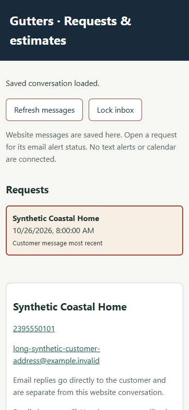
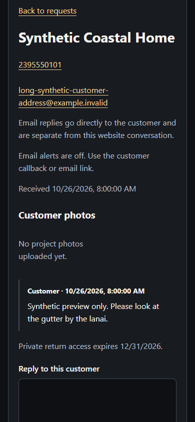
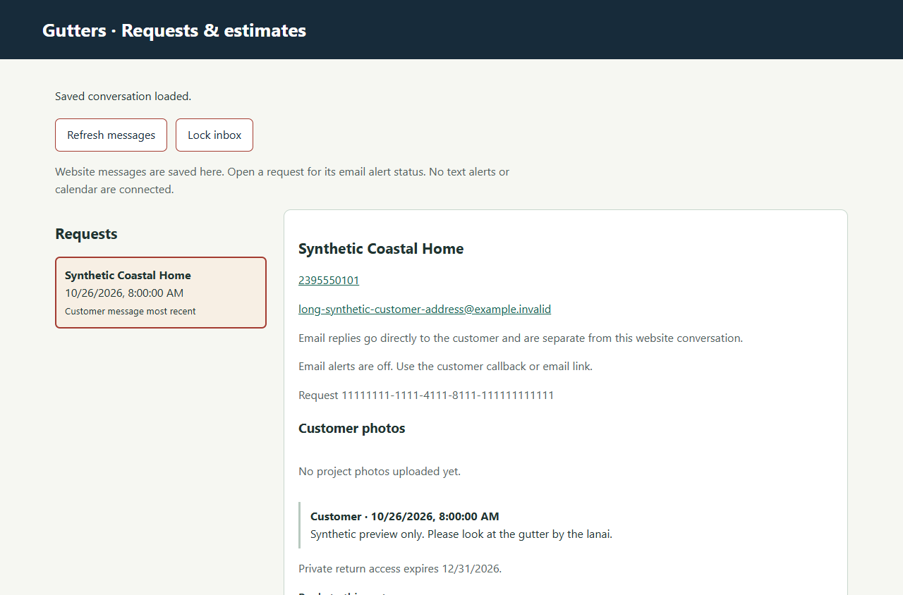
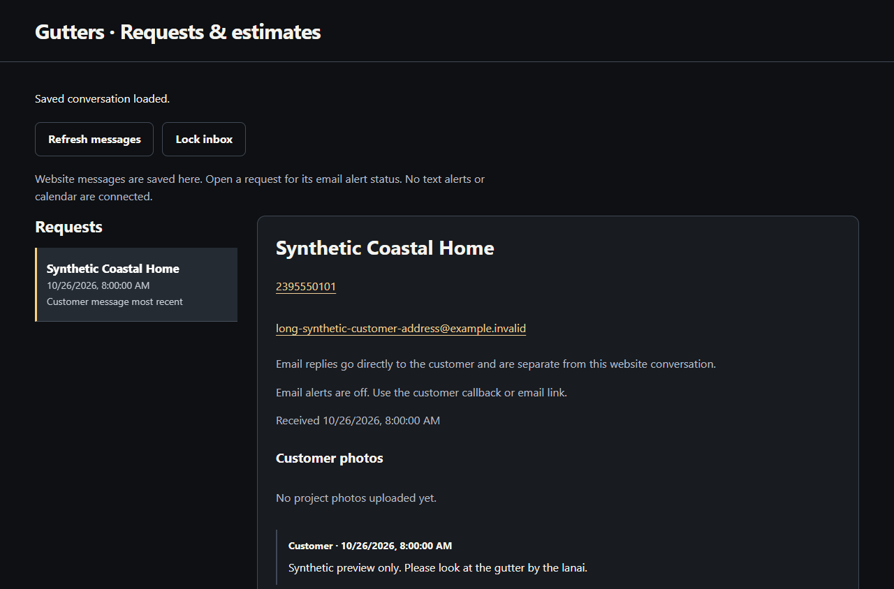

# Private inbox mobile polish

The owner inbox now uses a consistent dark palette, clear request rows, one restrained accent, readable system typography and more space between actions and forms. The existing public Americana pages keep their design. No framework, data model, API, send behavior, provider configuration or deployment changes are included.

Opening a successfully loaded request focuses its heading and brings its details into view on narrow screens. A mobile Back to requests link returns to the named list heading. Failed or stale selections do not announce an empty request. The detail header uses the received date already available in the request list rather than displaying an internal UUID.

Synthetic Chrome checks at 320, 390, 768 and 1280 CSS pixels verified:

- No horizontal page overflow with a long email address.
- Form controls use 16px text; buttons, inputs, textareas, selects and disclosure summaries meet a 44px minimum target height.
- Successful selection receives focus; the mobile return link focuses the request list.
- No browser page errors; native dark controls follow the page color scheme.

The prior two disclosure summaries were below 44px and choosing a request left focus on the list button. The new owner-selection regression covers successful focus, failure recovery and the received date while the existing authorization, uncertain-send, estimate and stale-photo tests remain in place.

These images contain only explicitly synthetic preview data. They were rendered against a temporary loopback HTTP fixture with no production access, tokens, SQLite database or real customer messages. They are review evidence, not a published runtime claim.

| Before | After |
| --- | --- |
|  |  |
|  |  |

Source-only. Review and merge are separate from releasing the server and verifying the installed inbox on a real phone.
